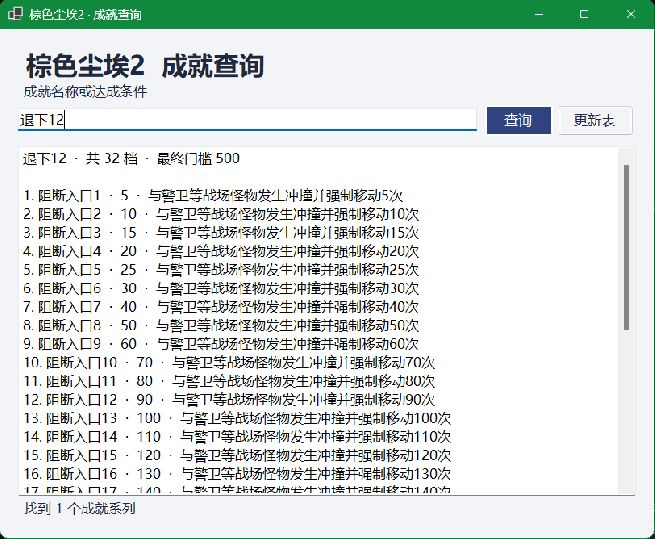

# 棕色尘埃2 · 成就查询

Windows 离线成就查询工具。输入成就名或达成条件，点「查询」或按 Enter。可滚动的结果区会列出同系列的各档名称、达成条件、累计门槛和最终门槛。点「更新表」可立即检查本机游戏数据。第一次查询以及游戏数据库或客户端程序集变更后的首次查询会自动重新导出。

## 使用

- Windows x64 双击运行 [x64 版](https://github.com/LynahZ/Bd2Achievement/releases/download/v0.1.0/Bd2Achievement-v0.1.0-win-x64.exe)。
- Windows 11 ARM64 双击运行 [ARM64 版](https://github.com/LynahZ/Bd2Achievement/releases/download/v0.1.0/Bd2Achievement-v0.1.0-win-arm64.exe)。窗口以 ARM64 原生运行，内置导出组件通过 Windows 的 x64 模拟层读取当前 x64 游戏客户端的数据。
- 两版都需要本机已安装《棕色尘埃2》并已有游戏数据。EXE 自带运行时，无需另外安装 PowerShell 或 .NET。导出过程在本地进行，无需启动游戏或登录账号。

程序默认扫描各磁盘的 `Neowiz\Browndust2`。自定义安装路径可在 Windows 用户环境变量中设置 `BD2_GAME_ROOT`，值为包含 `BrownDust II_Data` 的目录。游戏数据默认在 `%USERPROFILE%\AppData\LocalLow\Gamfs\BrownDust II\Data`，可以用 `BD2_DATA_ROOT` 指定其他位置。程序把导出的两张表缓存到 `%LOCALAPPDATA%\Bd2Achievement`，删除这个缓存目录后可自动重建。

示例查询「退下12」会显示 32 档，最后一档的累计门槛为 500 次。

## 从源码打包

构建机需要 [PowerShell 7.4 或以上](https://learn.microsoft.com/powershell/scripting/install/installing-powershell-on-windows)和 [.NET 10 SDK](https://dotnet.microsoft.com/download/dotnet/10.0)，首次还原需要能访问 NuGet。从本 README 所在目录运行：

~~~powershell
pwsh -NoProfile -File .\Publish-Windows.ps1
~~~

两个可分发文件是 `dist\x64\Bd2Achievement.exe` 和 `dist\arm64\Bd2Achievement.exe`。`dist\worker-x64` 是构建中间产物，ARM64 发布时会把它嵌入 EXE。

窗口和查询逻辑分别在 [App.cs](App.cs) 和 [Catalog.cs](Catalog.cs)。[TableExporter.cs](TableExporter.cs) 保留 Dustweave 的原始 MIT 声明和源码出处。

## 用 GitHub Actions 发布版本

先把要发布的提交推到主分支，再给包含发布工作流的提交打一个新的版本标签。下面用 `v0.2.0` 举例：

~~~powershell
git switch main
git pull --ff-only
git tag -a v0.2.0 -m "Bd2Achievement v0.2.0"
git push origin v0.2.0
~~~

推送匹配 `v*` 的标签后，[Windows release 工作流](.github/workflows/release.yml)会构建两版独立 EXE，并上传到该标签的 [Release](https://github.com/LynahZ/Bd2Achievement/releases)。附件命名为 `Bd2Achievement-<版本标签>-win-x64.exe` 和 `Bd2Achievement-<版本标签>-win-arm64.exe`，构建和上传进度可在 [Actions](https://github.com/LynahZ/Bd2Achievement/actions) 查看。

如果标签已有 Release，工作流只补传缺少的附件。`v0.1.0` 由原有的手动发布保留，工作流会跳过这个标签。
